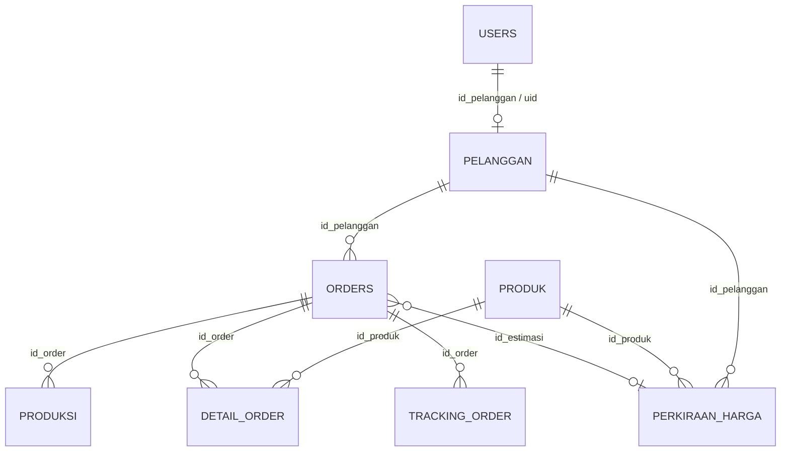

# Struktur Database — MoonindieStore

Dokumen ini merinci struktur **Cloud Firestore (Standard)** yang dipakai proyek
MoonindieStore, termasuk koleksi, field, relasi, aturan akses, Storage, dan
index yang dibutuhkan.

- Sumber kebenaran tipe: [`src/types/firestore.ts`](src/types/firestore.ts)
- Nama koleksi: [`src/lib/firebase/collections.ts`](src/lib/firebase/collections.ts)
- Akses data: [`src/lib/db.ts`](src/lib/db.ts)
- Aturan akses: [`firestore.rules`](firestore.rules) dan [`storage.rules`](storage.rules)

---

## 1. Strategi Desain

1. **Satu entitas = satu top-level collection.** Tidak memakai sub-collection
   agar pemetaan dari ERD relasional tetap 1:1 dan mudah dipahami.
2. **Relasi FK disimpan sebagai string `docId`** (`id_pelanggan`, `id_order`,
   `id_produk`, `id_estimasi`).
3. **Doc ID adalah identitas utama.** Field `id_*` bersifat virtual dan diambil
   dari doc ID saat membaca data (`withId()`); hanya `users.uid` yang benar-benar
   disimpan sebagai field.
4. **Audit timestamp** `createdAt` / `updatedAt` memakai `serverTimestamp()`.
5. **Penulisan atomik** untuk order + detail + tracking memakai `writeBatch()`.

---

## 2. Pohon Koleksi & Dokumen

```text
firestore/
│
├── users/{uid}                          ← doc id = Firebase Auth UID
│   ├── uid            : string          (sama dengan doc id)
│   ├── email          : string
│   ├── role           : "admin" | "owner" | "customer"
│   ├── id_pelanggan   : string | null   → pelanggan/{id}
│   ├── nama           : string
│   └── createdAt      : Timestamp
│
├── pelanggan/{autoId}                   ← doc id = id_pelanggan (virtual)
│   ├── nama           : string
│   ├── no_hp          : string
│   ├── email          : string
│   ├── alamat         : string
│   ├── uid            : string | null   → users/{uid}
│   ├── createdAt      : Timestamp
│   └── updatedAt      : Timestamp
│
├── produk/{autoId}                      ← doc id = id_produk (virtual)
│   ├── nama_produk    : string
│   ├── jenis_produk   : string          (merchandise | pakaian | cetak | ...)
│   ├── harga_dasar    : number
│   ├── satuan         : string          (pcs | meter | ...)
│   ├── gambar_url?    : string | null   → Storage produk/{file}
│   ├── gambar_path?   : string | null
│   ├── createdAt      : Timestamp
│   └── updatedAt      : Timestamp
│
├── orders/{autoId}                      ← doc id = id_order (virtual)
│   ├── id_pelanggan    : string         → pelanggan/{id}
│   ├── tgl_order       : Timestamp
│   ├── total_harga     : number         (= Σ detail_order.subtotal)
│   ├── status_order    : "menunggu" | "diproses" | "produksi" | "selesai" | "dibatalkan"
│   ├── estimasi_selesai: Timestamp | null
│   ├── id_estimasi?    : string | null  → perkiraan_harga/{id}
│   ├── createdAt       : Timestamp
│   └── updatedAt       : Timestamp
│
├── detail_order/{autoId}                ← doc id = id_detail (virtual)
│   ├── id_order        : string         → orders/{id}
│   ├── id_produk       : string         → produk/{id}
│   ├── jumlah          : number
│   ├── harga_satuan    : number
│   ├── subtotal        : number         (= jumlah × harga_satuan)
│   ├── spesifikasi     : string
│   ├── desain_url?     : string | null  → Storage desain/{id_order}/{file}
│   ├── desain_path?    : string | null
│   └── catatan_desain? : string
│
├── produksi/{autoId}                    ← doc id = id_produksi (virtual)
│   ├── id_order        : string         → orders/{id}
│   ├── tahap_produksi  : "persiapan_bahan" | "cetak_potong" | "finishing_qc"
│   │                     | "pengemasan" | "siap_kirim"
│   ├── status_produksi : "antri" | "berjalan" | "selesai" | "gagal"
│   ├── waktu_mulai     : Timestamp | null
│   ├── waktu_selesai   : Timestamp | null
│   └── keterangan      : string
│
├── tracking_order/{autoId}              ← doc id = id_tracking (virtual)
│   ├── id_order        : string         → orders/{id}
│   ├── status          : string         ("Order dibuat", "Status order → selesai", ...)
│   ├── waktu           : Timestamp
│   └── keterangan      : string
│
└── perkiraan_harga/{autoId}             ← doc id = id_estimasi (virtual)
    ├── id_pelanggan    : string         → pelanggan/{id}
    ├── id_produk       : string         → produk/{id}
    ├── jumlah          : number
    ├── harga_satuan    : number
    ├── biaya_bahan     : number
    ├── biaya_produksi  : number
    ├── total_estimasi  : number         (= harga_satuan×jumlah + biaya_bahan + biaya_produksi)
    └── tanggal         : Timestamp
```

### Enum yang dipakai

| Enum | Nilai |
|---|---|
| `Role` | `admin`, `owner`, `customer` |
| `StatusOrder` | `menunggu`, `diproses`, `produksi`, `selesai`, `dibatalkan` |
| `StatusProduksi` | `antri`, `berjalan`, `selesai`, `gagal` |
| `TahapProduksi` | `persiapan_bahan`, `cetak_potong`, `finishing_qc`, `pengemasan`, `siap_kirim` |

---

## 3. Relasi Antar Koleksi



### Kardinalitas

| Relasi | Tipe | Keterangan |
|---|---|---|
| `users` → `pelanggan` | 1 : 0..1 | Hanya role `customer` yang punya `id_pelanggan` |
| `pelanggan` → `users` | 0..1 : 1 | Lewat `pelanggan.uid` (pelanggan lama hasil impor bisa `null`) |
| `pelanggan` → `orders` | 1 : N | Satu pelanggan dapat memiliki banyak order |
| `orders` → `detail_order` | 1 : N | Satu order berisi banyak item produk |
| `orders` → `produksi` | 1 : N | Satu order melewati beberapa tahap produksi |
| `orders` → `tracking_order` | 1 : N | Jejak audit perubahan status |
| `produk` → `detail_order` | 1 : N | Produk dapat muncul di banyak order |
| `pelanggan` → `perkiraan_harga` | 1 : N | Riwayat estimasi milik pelanggan |
| `produk` → `perkiraan_harga` | 1 : N | Estimasi mengacu ke satu produk |
| `perkiraan_harga` → `orders` | 0..1 : N | Order dapat dibuat dari estimasi (`orders.id_estimasi`) |

### Alur bisnis

```text
customer login
   └─> users/{uid} ──(id_pelanggan)──> pelanggan/{id}
                                            │
              ┌─────────────────────────────┼───────────────────────────┐
              ▼                             ▼                           ▼
        orders/{id}                perkiraan_harga/{id}          (profil customer)
              │                             │
              │◄──── orders.id_estimasi ────┘
              │
     ┌────────┼──────────────┬──────────────────┐
     ▼        ▼              ▼                  ▼
detail_order produksi   tracking_order    (total dari detail)
     │
     └──> produk/{id}   ←── perkiraan_harga.id_produk
```

---

## 4. Aturan Akses (Firestore Rules)

Ringkasan dari `firestore.rules`:

| Koleksi | Read | Create | Update / Delete |
|---|---|---|---|
| `users` | diri sendiri + admin | diri sendiri, `role` wajib `customer` | admin |
| `pelanggan` | admin, owner, customer pemilik (`uid`) | user login untuk `uid` sendiri | update: admin/pemilik; delete: admin |
| `produk` | publik | admin | admin |
| `orders` | admin, owner, customer pemilik order | admin / customer untuk dirinya | update: admin; delete: admin atau customer jika `status_order == "menunggu"` |
| `detail_order` | admin, owner, customer pemilik order | admin / customer pada ordernya | update: admin; delete: admin/customer jika order `menunggu` |
| `produksi` | admin, owner, customer pemilik order | admin | admin |
| `tracking_order` | admin, owner, customer pemilik order | admin / customer dengan `status == "Order dibuat"` | update: admin; delete: admin/customer jika order `menunggu` |
| `perkiraan_harga` | admin, owner, customer pemilik | admin / customer | admin |

Catatan:

- Kepemilikan order ditelusuri melalui
  `orders.id_pelanggan → pelanggan.uid == request.auth.uid`.
- Aturan `orders` memakai `getAfter()` / `existsAfter()` agar mendukung batch
  write saat dokumen belum ada.
- Cookie `mis_role` di `proxy.ts` hanya untuk redirect optimistis; otorisasi
  final tetap di Firestore Rules.

---

## 5. Firebase Storage

```text
storage/
├── produk/{timestamp-random}.{ext}
│     akses : publik read, admin write
│     batas : max 2 MB, contentType image/*
│
└── desain/{id_order}/{timestamp-random}.{ext}
      akses : auth read; customer pemilik order berstatus "menunggu"
              atau admin write
      batas : max 10 MB, contentType image/* atau application/pdf
```

Referensi file disimpan di:

| Bucket path | Field Firestore |
|---|---|
| `produk/...` | `produk.gambar_url`, `produk.gambar_path` |
| `desain/{id_order}/...` | `detail_order.desain_url`, `detail_order.desain_path` |

---

## 6. Index & Query

Tidak ada **composite index** yang dibutuhkan karena query sengaja menghindari
kombinasi `where + orderBy` (pengurutan dilakukan di client).

| Koleksi | Query | Index |
|---|---|---|
| `orders` | `where("id_pelanggan","==",...)` + sort client | single-field otomatis |
| `orders` | `orderBy("tgl_order","desc")` + `limit(max)` | single-field otomatis |
| `detail_order` | `where("id_order","==",...)` | single-field otomatis |
| `detail_order` | `where("id_order","in",[...])` (chunk 10) | single-field otomatis |
| `produksi` | `where("id_order","==",...)` | single-field otomatis |
| `tracking_order` | `where("id_order","==",...)` | single-field otomatis |
| `perkiraan_harga` | `where("id_pelanggan","==",...)` | single-field otomatis |
| `perkiraan_harga` | `orderBy("tanggal","desc")` + `limit(max)` | single-field otomatis |
| `produk` | `orderBy("nama_produk")` | single-field otomatis |
| `users` | `orderBy("email")` | single-field otomatis |

---

## 7. Invarian Data Penting

1. Satu user Firebase Auth = tepat satu `users/{uid}` = maksimal satu
   `pelanggan` (relasi dua arah `users.id_pelanggan` ↔ `pelanggan.uid`).
2. `orders.total_harga` = jumlah `detail_order.subtotal` milik order tersebut.
3. `detail_order.subtotal` = `jumlah × harga_satuan`.
4. `perkiraan_harga.total_estimasi` =
   `harga_satuan × jumlah + biaya_bahan + biaya_produksi`.
5. `produksi` mengikuti urutan `TAHAP_PRODUKSI`; progres customer dihitung dari
   tahap terjauh yang berstatus `selesai` (100% bila `siap_kirim` selesai).
6. `tracking_order` adalah audit trail; entri awal wajib `"Order dibuat"`.
7. Pembuatan order + detail + tracking dilakukan atomik via `writeBatch()`
   (`createOrderWithDetailsBatch`).
8. Customer hanya boleh membatalkan/menghapus order yang masih `menunggu`.

---

## 8. Contoh Dokumen

### `users/{uid}`

```json
{
  "uid": "AbCdEf123456",
  "email": "budi@example.com",
  "role": "customer",
  "id_pelanggan": "p3l4ngg4n01",
  "nama": "Budi Santoso",
  "createdAt": "<Timestamp>"
}
```

### `pelanggan/{autoId}`

```json
{
  "nama": "Budi Santoso",
  "no_hp": "081234567890",
  "email": "budi@example.com",
  "alamat": "Jl. Merdeka No. 10, Bandung",
  "uid": "AbCdEf123456",
  "createdAt": "<Timestamp>",
  "updatedAt": "<Timestamp>"
}
```

### `produk/{autoId}`

```json
{
  "nama_produk": "Kaos Katun Combed 30s",
  "jenis_produk": "pakaian",
  "harga_dasar": 55000,
  "satuan": "pcs",
  "gambar_url": "https://firebasestorage.googleapis.com/...",
  "gambar_path": "produk/1720000000-ab12cd.jpg",
  "createdAt": "<Timestamp>",
  "updatedAt": "<Timestamp>"
}
```

### `orders/{autoId}`

```json
{
  "id_pelanggan": "p3l4ngg4n01",
  "tgl_order": "<Timestamp>",
  "total_harga": 175000,
  "status_order": "menunggu",
  "estimasi_selesai": "<Timestamp | null>",
  "id_estimasi": "e5t1m4s101",
  "createdAt": "<Timestamp>",
  "updatedAt": "<Timestamp>"
}
```

### `detail_order/{autoId}`

```json
{
  "id_order": "0rd3r0001",
  "id_produk": "pr0duk001",
  "jumlah": 3,
  "harga_satuan": 55000,
  "subtotal": 165000,
  "spesifikasi": "Kaos hitam, sablon depan 1 warna",
  "desain_url": "https://firebasestorage.googleapis.com/...",
  "desain_path": "desain/0rd3r0001/1720000000-xy98zz.png",
  "catatan_desain": "Logo di dada kiri, ukuran 8 cm"
}
```

### `produksi/{autoId}`

```json
{
  "id_order": "0rd3r0001",
  "tahap_produksi": "cetak_potong",
  "status_produksi": "berjalan",
  "waktu_mulai": "<Timestamp>",
  "waktu_selesai": null,
  "keterangan": "Menunggu antrean cetak"
}
```

### `tracking_order/{autoId}`

```json
{
  "id_order": "0rd3r0001",
  "status": "Order dibuat",
  "waktu": "<Timestamp>",
  "keterangan": ""
}
```

### `perkiraan_harga/{autoId}`

```json
{
  "id_pelanggan": "p3l4ngg4n01",
  "id_produk": "pr0duk001",
  "jumlah": 3,
  "harga_satuan": 55000,
  "biaya_bahan": 15000,
  "biaya_produksi": 10000,
  "total_estimasi": 190000,
  "tanggal": "<Timestamp>"
}
```
